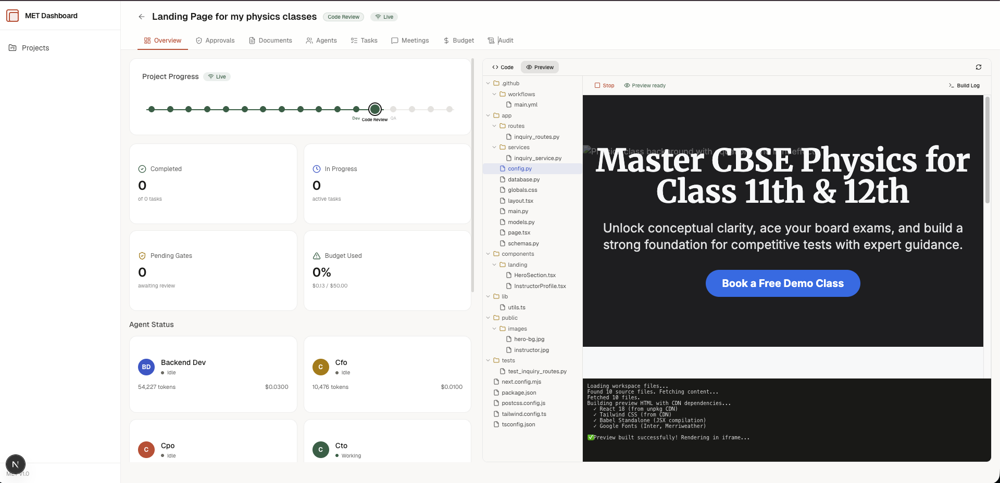
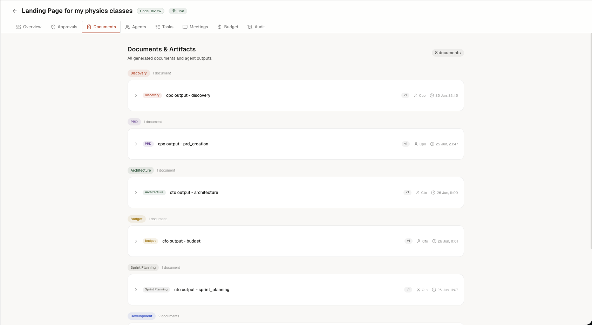
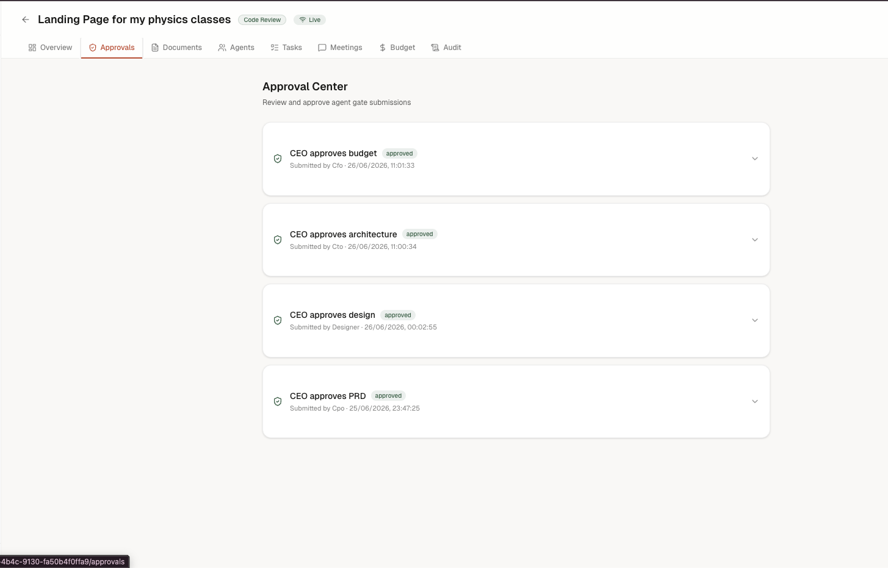
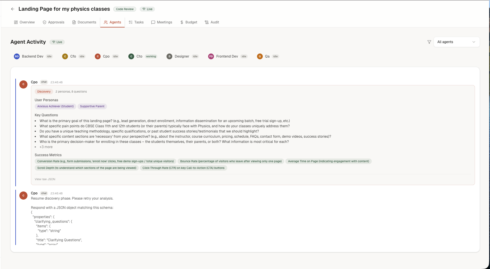
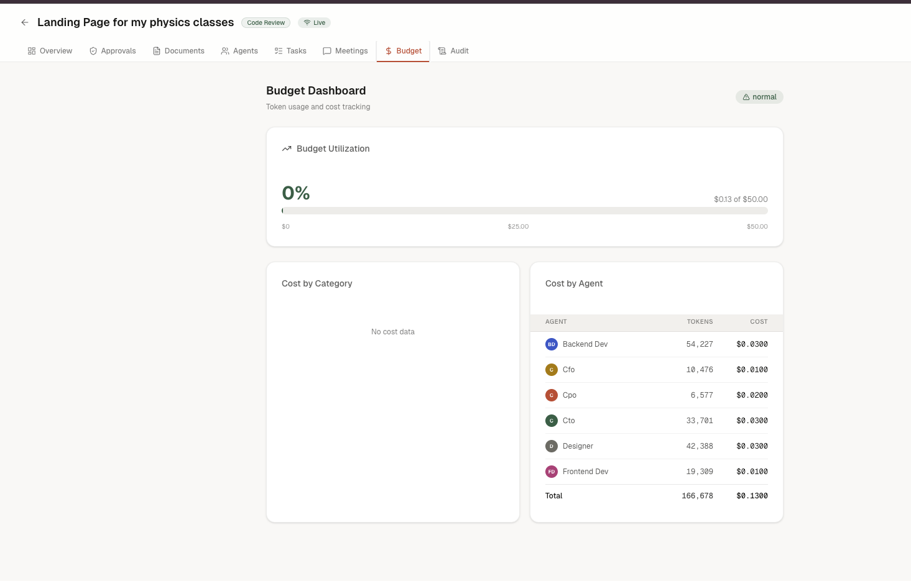

# 🤖 MET — Multi-Agent Executive Team (SaaS Builder)

> **An autonomous, multi-agent AI software development platform** that simulates a complete tech company's executive team and engineering department to build entire software projects from a single prompt.

[](#)
[](#)

---

## 📋 Table of Contents

- [Project Overview](#project-overview)
- [Tech Stack](#tech-stack)
- [Architecture & Workflow](#architecture--workflow)
- [Meet the AI Team](#meet-the-ai-team)
- [Key Technical Highlights](#key-technical-highlights)
- [Getting Started](#getting-started)
- [Project Structure](#project-structure)
- [Testing](#testing)

---

## 🎯 Project Overview

**MET (Multi-Agent Executive Team)** is an end-to-end software development engine. Instead of a single chat interface, MET spins up a virtual software company with specialized AI agents (CPO, CTO, CFO, Devs, QA). The agents debate, plan, budget, write code, review PRs, and test software completely autonomously, pausing only at explicit "Approval Gates" for human (CEO) sign-off.

### Core Philosophy
1. **Specialization over Generalization**: Distinct AI personas with constrained capabilities, unique context, and specific system prompts.
2. **Deterministic Orchestration**: LLMs do the thinking, but a strict Python State Machine governs transitions, task assignment, and error recovery. No recursive LLM loops.
3. **Structured Outputs Only**: Every LLM output is strictly validated against Pydantic v2 JSON schemas before hitting the database.

---

## 📸 Demo

<div align="center">
  
  
  
  
  
</div>

---

## 💻 Tech Stack

| Layer | Technology | Rationale |
|---|---|---|
| **Frontend** | Next.js 15 (App Router), TypeScript, Tailwind CSS, shadcn/ui | Fast UI iteration, Server Components, interactive workspaces |
| **Backend** | FastAPI, Python 3.12+ | High-performance async REST & WebSocket endpoints |
| **AI/LLM** | Google Gemini (`gemini-2.0-flash`) | Fast reasoning, cost-effective, massive context window |
| **Database** | PostgreSQL 16 + SQLAlchemy 2.0 (asyncpg) | Durable state, audit logs, ledger-based task tracking |
| **Cache/PubSub** | Redis | Ephemeral cache and WebSocket event broadcasting |
| **Migrations** | Alembic | Async-compatible database schema versioning |

---

## 🏗️ Architecture & Workflow

MET is driven by a 15-stage state machine that models the software development lifecycle:

```text
Briefing ➔ Discovery ➔ PRD Creation ➔ [GATE 1: PRD Review] ➔ Architecture ➔ [GATE 2: Arch & Budget] ➔ Sprint Planning ➔ Development ➔ Code Review ➔ QA Testing ➔ [GATE 3: UAT] ➔ Deployment
```

### System Flow
1. **Next.js Dashboard**: The human (CEO) inputs a project brief and monitors the live agent activity feed.
2. **FastAPI Orchestrator**: Routes events, validates state transitions, manages agent lifecycles, and enforces human-in-the-loop approval gates.
3. **Agent Manager**: Spawns isolated `asyncio` tasks for agents to perform work.
4. **Sandboxed Workspaces**: Generated code is physically segregated into `workspaces/{project_id}/`, complete with local `.git` repositories and simulated branches.

---

## 👔 Meet the AI Team

- **👑 CEO (Human)**: You. You provide the brief, approve PRDs, sign off on budgets, and approve the final release.
- **🚀 CPO (Chief Product Officer)**: Conducts discovery, drafts user stories, and creates the definitive Product Requirements Document (PRD).
- **🏗️ CTO (Chief Technology Officer)**: Designs system architecture, breaks down epics into actionable tasks, and performs strict code reviews.
- **💰 CFO (Chief Financial Officer)**: Calculates API token costs, generates budgets, and enforces hard-stop spending guardrails.
- **💻 Backend / Frontend Devs**: Writes isolated code. Each agent owns a specific domain (`src/backend` vs `src/frontend`) to prevent merge conflicts.
- **🐛 QA Reviewer**: Generates test plans, reviews features, files bug reports, and ensures acceptance criteria are met.

---

## ✨ Key Technical Highlights (Enterprise Grade)

1. **Deterministic State Machine**: Replaces unpredictable LLM agent-loops with a rigid, Python-based orchestrator. Agents cannot go rogue; they only act when the state machine permits.
2. **The Meeting Engine**: A moderated, round-robin LLM debate system. Agents (with differing context—e.g., CTO sees constraints, CFO sees costs) debate technical approaches. The system actively penalizes sycophancy. A separate LLM call extracts the final consensus and action items.
3. **Cost Guardrails**: Hard limits enforced at the framework level. The CFO agent tracks costs down to the token. If a project hits 95% of its $50 budget, all async tasks are instantly paused to prevent runaway billing.
4. **Strict Schema Validation**: All agent responses are forced into Pydantic models. If an agent hallucinates a JSON key, the orchestrator automatically feeds the `ValidationError` back into the LLM prompt for up to 3 self-correction retries before escalating to the CTO.

---

## 🚀 Getting Started

### Prerequisites
- Docker & Docker Compose
- Node.js & npm (for local development)
- Python 3.12+ (for local backend development)
- A Google Gemini API Key

### 🐳 Full Stack Deployment (Docker)

The fastest way to get started.

```bash
# 1. Clone & Setup Environment
cp .env.example .env

# 2. Add your Gemini API Key to .env
# MET_GEMINI_API_KEY=your_key_here

# 3. Spin up the stack (Postgres, Redis, Backend, Frontend)
docker compose up -d
```
Access the dashboard at `http://localhost:3000`.

### 💻 Local Development Mode

If you want to run the services bare-metal for active development:

**Terminal 1: Backend & Databases**
```bash
cd backend
pip install -e ".[dev]"

# Start dependencies
docker compose up -d postgres redis

# Run migrations
alembic upgrade head

# Start FastAPI server
uvicorn app.main:app --reload --port 8000
```

**Terminal 2: Frontend Dashboard**
```bash
cd frontend
npm install
npm run dev
```

---

## 📂 Project Structure

```text
met-system/
├── backend/                      # Python backend
│   ├── alembic/                  # DB migrations
│   ├── app/
│   │   ├── agents/               # AI Persona classes & Prompts
│   │   ├── api/                  # REST & WS endpoints
│   │   ├── core/                 # Events, Exceptions, Redis setup
│   │   ├── llm/                  # LLM Provider integrations
│   │   ├── meetings/             # Multi-agent debate engine
│   │   ├── models/               # SQLAlchemy DB schemas
│   │   ├── orchestrator/         # Deterministic State Machine
│   │   ├── schemas/              # Pydantic validation (API + Agents)
│   │   └── services/             # Git, Cost Tracking, Context Loading
├── frontend/                     # Next.js Application
│   ├── src/
│   │   ├── app/                  # App Router pages (Dashboard, Project View)
│   │   ├── components/           # React Components (UI + Workspaces)
│   │   └── lib/                  # API client & utilities
├── workspaces/                   # Local code generation directory
└── docs/                         # Extended documentation & system design
```

---

## 🧪 Testing

The backend includes a comprehensive test suite covering validation, state transitions, and integration with mocked LLMs.

```bash
cd backend

# Run fast unit tests (no DB needed)
pytest tests/unit/ -v

# Run integration tests (requires Postgres/Redis)
pytest tests/integration/ -v

# Run E2E Smoke test (Costly: hits actual Gemini API)
pytest tests/e2e/ -v

# Check coverage
pytest --cov=app --cov-report=term-missing
```

---
*Built to simulate the future of software development.*
CDR69P
